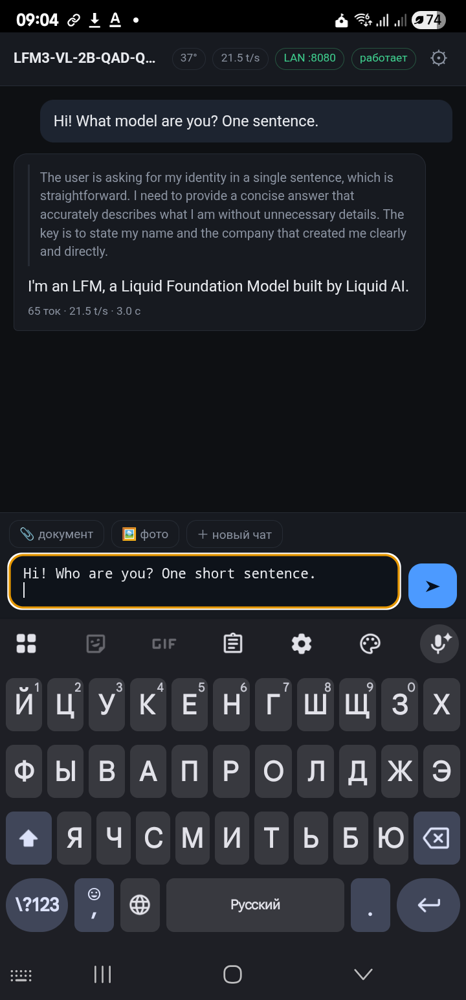
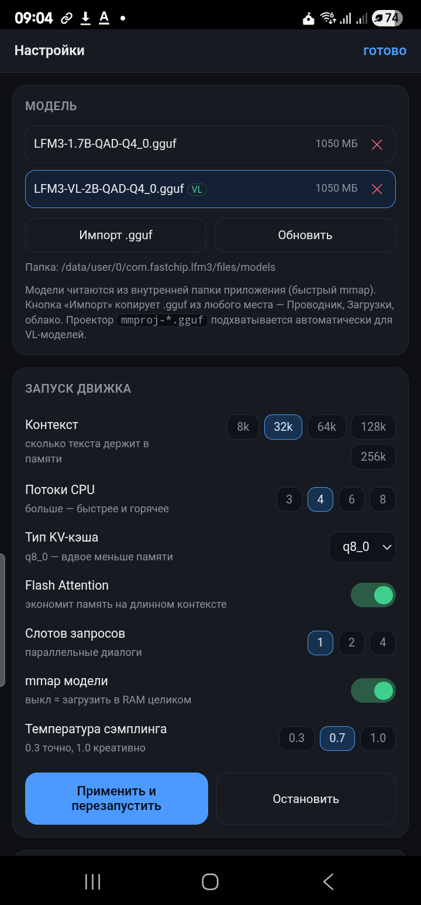
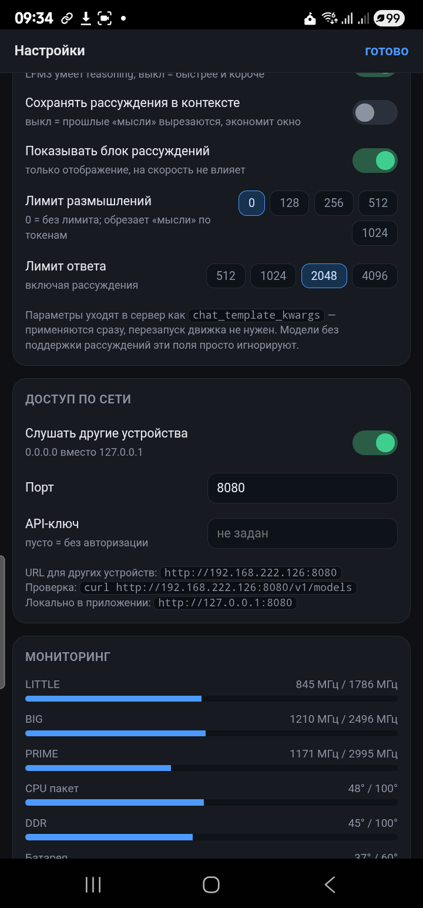
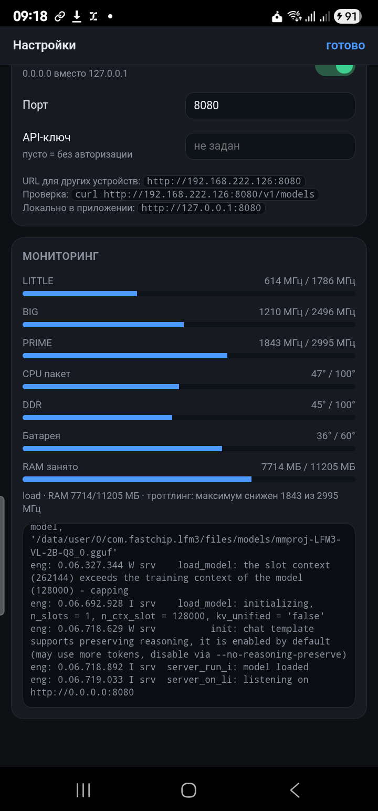
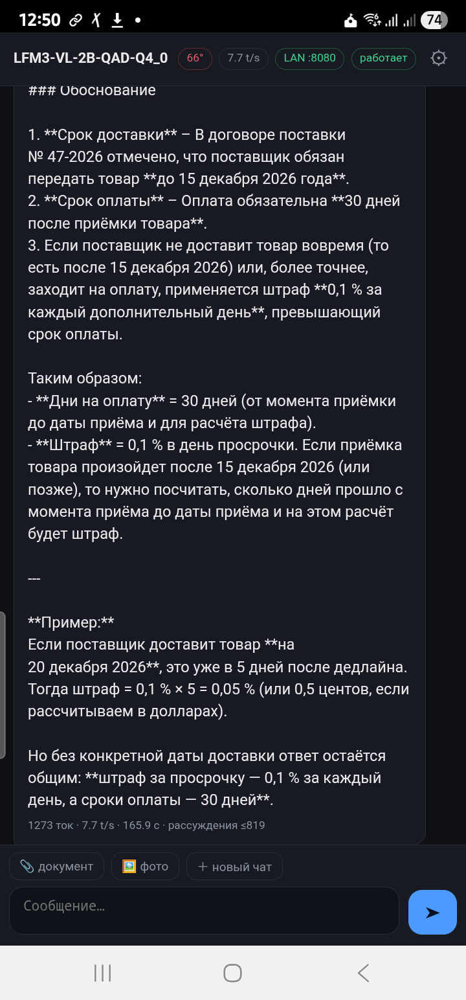
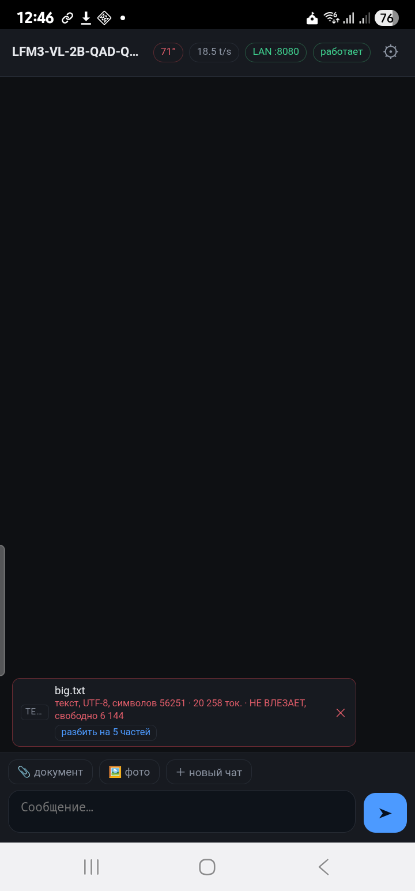
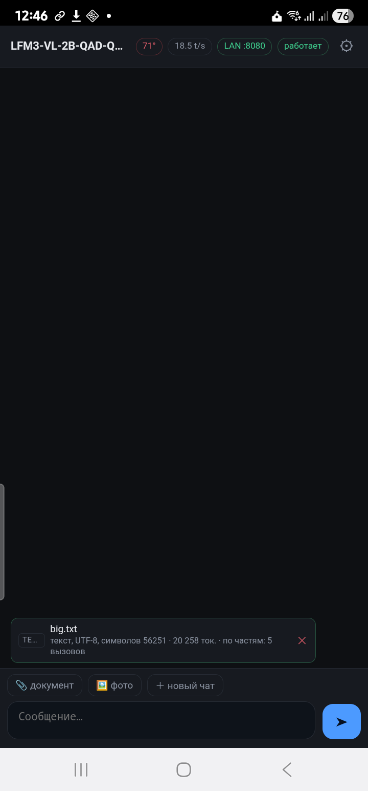

# LFM3 Android

Локальный LLM-движок для Android: [LiquidAI LFM3](https://huggingface.co/LiquidAI/LFM3-1.7B) (и её VL-версия) работает на телефоне без интернета, с настройками запуска, вложениями, сетевым доступом и мониторингом железа.

Внутри — [llama.cpp](https://github.com/ggml-org/llama.cpp), собранный под arm64 с `dotprod+i8mm+bf16+fp16` и KleidiAI вместо обычной NDK-сборки. APK собирается без Gradle: `aapt2` + `javac` + `d8` + `apksigner`.

Проверено на Samsung Galaxy S22 Ultra (SM-S908E, Snapdragon 8 Gen 1, Adreno 730, 12 ГБ, Android 16).

## Скриншоты

| Чат | Модели и запуск |
|---|---|
|  |  |

| Рассуждения | Мониторинг |
|---|---|
|  |  |

| Документ обработан целиком | Не влезает → отказ с цифрами | Разбито на части |
|---|---|---|
|  |  |  |

## Что умеет

- **Чат со стримингом**, отдельный сворачиваемый блок рассуждений, счётчик токенов в секунду.
- **Модели:** список `.gguf` внутри приложения, импорт из любого места через системный Проводник, удаление, авто-подключение `mmproj` для VL-моделей.
- **Запуск:** контекст 8k…256k, потоки 3/4/6/8, KV-кэш `f16/q8_0/q4_0`, Flash Attention, слоты 1/2/4, mmap, температура сэмплинга.
- **Рассуждения** (`chat_template_kwargs`, применяются без перезапуска): `enable_thinking`, `preserve_thinking`, `reasoning_budget_tokens`, лимит ответа.
- **Вложения:** документы целиком (docx/xlsx/pptx/odt/epub/pdf/txt — без обрезки, с точным подсчётом токенов) и фото (1280 px, JPEG base64 — нужна VL-модель).
- **Доступ по сети:** bind `0.0.0.0`, порт, API-ключ, показ готового URL. OpenAI-совместимый API — с ПК работает `curl`, любой клиент.
- **Мониторинг:** температуры (CPU-пакет/DDR/батарея), частоты LITTLE/BIG/PRIME против максимума (видно троттлинг), RAM, load, живой лог движка.

## Документы: без обрезки

Абзац «первые 12 000 символов» из прошлых версий удалён. Правило теперь одно: файл либо попадает в промпт **целиком**, либо отклоняется с точной причиной.

| формат | как читается |
|---|---|
| `txt, md, csv, json, xml, yaml, html, log, код` | как текст; кодировка определяется (BOM, UTF-8, windows-1251), двоичные файлы отсекаются по служебным байтам |
| `docx` | `word/document.xml` → абзацы, табы, таблицы |
| `xlsx` | `sharedStrings` + листы, строки через таб |
| `pptx` | текст слайдов по порядку |
| `odt / ods / odp` | `content.xml` |
| `epub` | все xhtml-главы |
| `pdf` | pdf.js 3.11 (UMD, в assets) — текстовый слой постранично; сканы без OCR честно отклоняются |
| `doc, xls, ppt, rtf` | отклоняются с подсказкой пересохранить в новый формат |

Перед отправкой текст прогоняется через `/tokenize` самого движка (не оценка «на глаз»), и чип вложения показывает: `docx, абзацев 5, символов 160 · 61 ток. · влезает, свободно 6 144`.

Если не влезает — чип красный: `56 251 символов · 20 258 ток. · НЕ ВЛЕЗАЕТ, свободно 6 144`, отправка блокируется с сообщением, и предлагается кнопка **«разбить на N частей»**. После неё файл обрабатывается последовательно: каждая часть уходит отдельным вызовом (~70% свободного окна), в чате видно `часть 3 из 5 — извлекаю факты…`, а финальный ответ строится по выжимке всех частей с пометкой «обработан ПОЛНОСТЬЮ».

Пределы, о которых приложение говорит прямо: файл больше 32 МБ и старый бинарный Office не читаются вовсе — это отказ, а не тихая обрезка.

## Замеры (S22 Ultra, LFM3-1.7B QAD-Q4_0, `-t 4`)

| сборка | промпт | генерация |
|---|---|---|
| обычная NDK-сборка | 14,5 t/s | 9,6 t/s |
| `dotprod+i8mm` | 69,7 t/s | 14,5 t/s |
| `+ KleidiAI` (эта) | **100,7 t/s** | **23,1 t/s** |

Живой чат в приложении: 72–87 t/s промпт, 18–19 t/s генерация, RSS 2,36 ГБ при 32k контекста.

Зрение (`LFM3-VL-2B-QAD-Q4_0` + `mmproj-LFM3-VL-2B-Q8_0`): скриншот 420×900 распознан за 11,1 с, промпт 43 t/s, выдача 23,6 t/s.

Бюджет рассуждений (LFM3-VL-2B):

| режим | reasoning-токенов | время ответа |
|---|---|---|
| без лимита | 169 | 23,8 с |
| `reasoning_budget_tokens: 64` | 43 | 8,8 с |
| `enable_thinking: false` | 0 | 0,4 с |

## Сборка

Нужны JDK 21, Android SDK (`platforms;android-34`, `build-tools;34.0.0`) и собранный под Android llama.cpp:

```bash
git clone https://github.com/ggml-org/llama.cpp && cd llama.cpp
# универсальный движок: несколько ISA-вариантов внутри одной libggml-cpu.so,
# выбор по железу в рантайме (i8mm на 8 Gen 1, dotprod на SM6150, базовый — остальное)
cmake -B build-uni -DCMAKE_TOOLCHAIN_FILE=$ANDROID_NDK/build/cmake/android.toolchain.cmake \
      -DANDROID_ABI=arm64-v8a -DANDROID_PLATFORM=android-29 -DCMAKE_BUILD_TYPE=Release \
      -DGGML_NATIVE=OFF -DGGML_CPU_ALL_VARIANTS=ON -DGGML_CPU_KLEIDIAI=ON \
      -DGGML_OPENMP=OFF -DLLAMA_CURL=OFF
cmake --build build-uni --target llama-server -j
```
Для одного устройства быстрее точная сборка (`-DGGML_CPU_ARM_ARCH="armv8.2-a+dotprod+i8mm+bf16+fp16"`
для 8 Gen 1 / `armv8.2-a+dotprod+fp16` для SM6150) — универсальная стоит ~5% на Samsung.

```bash
export JAVA_HOME=/path/to/jdk-21
export ANDROID_SDK=/path/to/sdk
export LLAMA_BUILD=/path/to/llama.cpp/build-android/bin
bash scripts/build_apk.sh
```

Скрипт соберёт `build/LFM3.apk` и сам создаст отладочный keystore.

## Профили устройств

Приложение одно, но дефолты подобраны под каждое железо (`Bridge.deviceProfile()`,
по `Build.SOC_MODEL`; остальное — по объёму ОЗУ: ≥10 ГБ → 4t/32k, меньше → 2t/8k):

| SoC | Устройство | ОЗУ | нити | контекст |
|---|---|---|---|---|
| SM8450 (8 Gen 1) | Galaxy S22 Ultra | 12 ГБ | 4 | 32768 |
| SM6150 (SD 732G) | POCO X3 NFC | 6 ГБ | 2 | 8192 |

Активный профиль виден в мониторинге («профиль SM6150»). Кластеры и термозоны
определяются автоматически по `cpuinfo_max_freq` и `/sys/class/thermal` — на 2+6
показывает LITTLE+BIG, на 1+3+4 все три; где нет `ddr`-датчика или читаемого
`scaling_max_freq` (SM6150) — UI не падает, а скрывает/не показывает троттлинг.

**POCO X3 NFC (SM6150, dotprod-сборка), `-pg 512,128`, t/s:**

| `-t` | pp512 | tg128 |
|---|---|---|
| **2** | **44,3** | **10,6** |
| 3 | 30,3 | 8,7 |
| 4 | 40,1 | 8,6 |
| 6 | 38,2 | 8,5 |

Три грабли SM6150: без флага `dotprod` базовый NEON даёт 10 т/с (×4 разницы);
`-t 3` проваливается (ядро A76 остаётся одно); `llama-bench` master — `-pg 512,128 -r N`,
старый синтаксис `-nr` больше не принимается.

## Модель

```bash
adb install -r build/LFM3.apk
# gguf кладём во внутреннюю папку приложения, а не на /sdcard
adb push LFM3-1.7B-QAD-Q4_0.gguf /data/local/tmp/m.gguf
adb shell "run-as com.fastchip.lfm3 sh -c 'mkdir -p files/models; cat /data/local/tmp/m.gguf > files/models/LFM3-1.7B-QAD-Q4_0.gguf'"
```

Либо в самом приложении: ⚙ → «Импорт .gguf».

Модели: [LFM3-1.7B-GGUF](https://huggingface.co/LiquidAI/LFM3-1.7B-GGUF), [LFM3-VL-2B-GGUF](https://huggingface.co/LiquidAI/LFM3-VL-2B-GGUF) (+ `mmproj` для зрения).

## API

Движок слушает `127.0.0.1:8080` (или `0.0.0.0` при включённом сетевом доступе):

```bash
curl http://<ip>:8080/v1/chat/completions -H "Content-Type: application/json" -d '{
  "messages": [{"role": "user", "content": "Привет"}],
  "chat_template_kwargs": {"enable_thinking": false},
  "reasoning_budget_tokens": 64
}'
```

## Инженерные заметки

Три вещи, без которых это не работало:

1. **Foreground-сервис обязателен.** Иначе Android замораживает приложение вместе с дочерним процессом, как только гаснет экран: порт слушается, запросы висят. Лечится `startForeground` + `PARTIAL_WAKE_LOCK`.
2. **Модель нельзя держать на `/sdcard`.** mmap через FUSE уводит процесс в D-state и запросы перестают обслуживаться. Только внутренняя память приложения.
3. **d8 из build-tools 34 падает с внутренним NPE на анонимных классах** — колбэки пишутся лямбдами или статическими вложенными классами.

Ограничения: NPU Hexagon v69 не используется (в llama.cpp ядра HTP только с v73), GPU OpenCL ускоряет лишь промпт (52 t/s) и замедляет генерацию (7 t/s против 23 t/s у CPU), после 30 минут нагрузки prime-ядро упирается в 1,84 ГГц и выдача падает до ~6 t/s.

## Лицензия

MIT. llama.cpp — MIT, модели LFM3 — по лицензии Liquid AI.